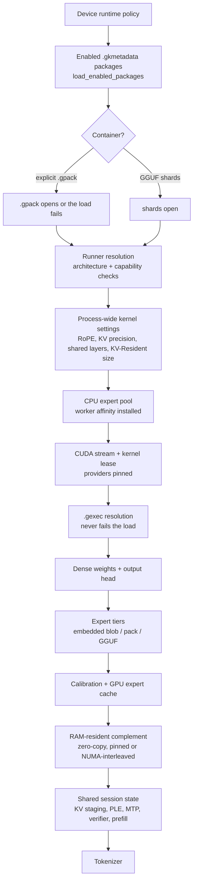
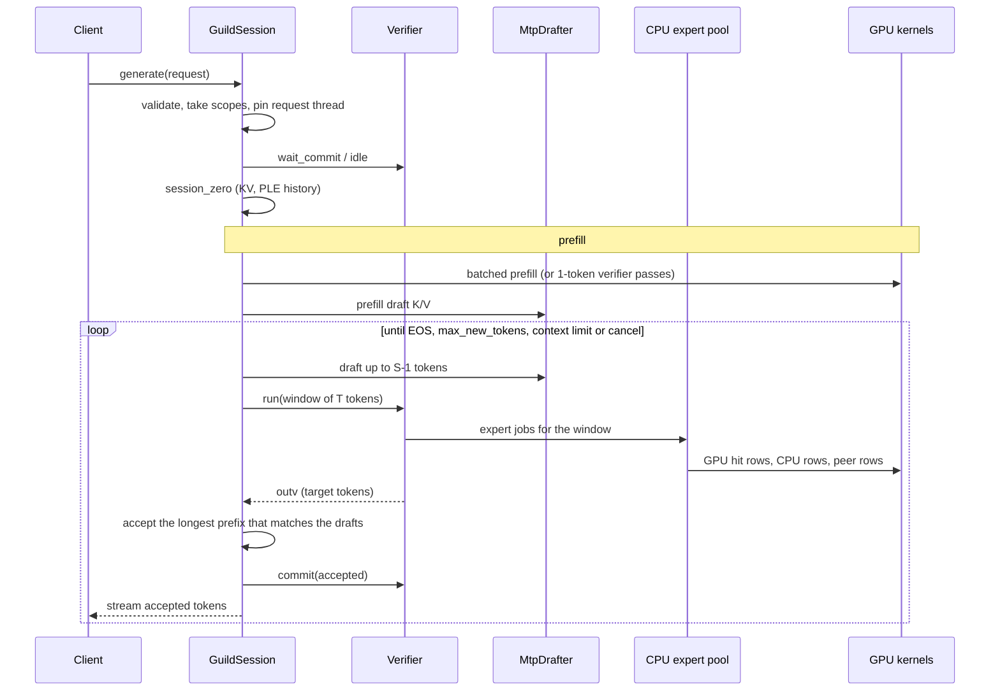

# Execution lifecycle

This document follows one process from `guild run` to a generated token: what happens at load, what a session is,
how a request is served, and which invariants hold across all of it. It is the narrative counterpart to
[MODULAR_RUNTIME.md](MODULAR_RUNTIME.md) (which explains the layering rule) and to the headers it cites (which
state each contract in full).

The order below is the order in the code. `GuildModel::load` in `src/runtime/model.cpp` performs exactly these
stages, and each stage is also a field of `StartupProfile`, so the startup JSON that a run prints is a timeline in
this order.

## 1. Startup: `GuildModel::load`

Notes on the stages that are easy to get wrong:

* **Ordering is a contract.** The pool installs worker affinity before any expert page is touched, so pages land
  on the intended NUMA node; the process-wide kernel settings are set before any weight is prepared, because the
  kernels read them while building quantized layouts and KV buffers; the kernel lease is taken before GEXEC
  resolution, so nothing can be unloaded underneath an artifact.
* **Failure semantics.** A load failure returns `nullptr` with a message - it never throws to the caller, since
  the entry points are C ABI. An explicitly named `.gpack` must open; a `model.gpack` sidecar found next to a
  pack directory is a convenience and falls back to the shards. A `.gexec` can never fail a load: an unusable
  artifact is recorded as a fallback reason in the startup profile.
* **Kernel selection.** Without GEXEC the default provider set is used. With GEXEC the artifact records which
  implementation won its measurement, and the runtime resolves that one - that is what makes an optimized run
  reproducible without re-tuning (see [GEXEC_CONTRACT.md](GEXEC_CONTRACT.md)).
* **Two calibrations.** The first measures CPU/GPU/copy cost per layer and decides expert placement (or reuses
  the GEXEC heterogeneous plan if it was measured on this same fingerprint). The second runs after pinning and
  cache sizing, because the PCIe share has to be planned against the memory that actually exists.

## 2. Sessions

`GuildModel::create_session()` returns a `GuildSession`: a handle, not a model copy.

| Per session | Shared by every session |
| --- | --- |
| Drafting state (`SuffixDrafter`, `DraftPolicy`) | Weights, expert tiers, expert cache |
| Cancellation flag | Device KV staging, PLE tables, verifier, prefill engine, tokenizer |
| Its runner and kernel leases | The CUDA stream and the CPU expert pool |

Two invariants hold for every entry point:

* **Fail-closed readiness.** `ready` is cleared and re-checked when a generation starts; any failure after the
  first device work leaves it false, so later requests are refused instead of running on a half-valid model.
* **Pinning.** The runner and kernel leases taken by the model and by each session keep the resolved providers
  loaded and their streams alive. Package disable or uninstall therefore fails, rather than forcing an unload
  under a running session ([PHASE2E_PACKAGE_LIFECYCLE.md](PHASE2E_PACKAGE_LIFECYCLE.md)).

Generation is serialized by a model-wide lock: one process runs one generation at a time, and a session selects
which state that generation uses. Solo `curl` scripts and the web app both see queueing, not parallelism.

## 3. One request

* **Prefill** uses the batched engine (`BatchedPrefill`) when the architecture supports it and a sequential
  verifier loop otherwise. The prompt's *last* token is not consumed here: it becomes the first decode input, so
  the prompt's logits are produced by the decode path.
* **A speculative window** is `T` tokens: the last accepted token plus up to `T-1` drafts proposed by the MTP
  drafter. `T` grows while the drafter's confidence stays above `spec_min_p`, and is 1 for the first window or
  when no drafter is configured. The verifier runs the window through the real model; a draft is accepted exactly
  when greedy decode would have produced it, and `commit(accepted)` keeps the accepted prefix and restores the
  session state (KV cells, PLE history, indexer state) for the rejected suffix. Declined drafts cost GPU work,
  never correctness.
* **The expert pool** is where the model's cost lives: for each layer the pool thread decides which routed
  experts the primary GPU computes from its cache, which the peer GPU takes, and which the CPU computes from the
  pinned tier - all at once, so the two devices' work overlaps.
* **Cancellation** is cooperative: `cancel()` sets a flag that the prefill and decode loops poll, and a
  disconnected streaming client stops the callback, which cancels the generation.

## 4. Why the hot path has no dispatch

Resolution (runner, kernels, package binding, function pointers) all happens during load and session setup. The
token and layer loops then execute pre-bound function pointers and launch captured CUDA graphs. This is not a
style preference: at ~20-50 decode tokens per second on a mid-range GPU, a per-layer registry lookup or virtual
call is measurable, and it is the reason the layering works through registries rather than base classes.

## See also

* [README.md](README.md) - the component map and the artifact flow.
* [MODULAR_RUNTIME.md](MODULAR_RUNTIME.md) - the three layers and the phase history.
* [GEXEC_CONTRACT.md](GEXEC_CONTRACT.md) - what the artifact in stage 6 contains and when it is invalidated.
* [GPACK_FORMAT.md](GPACK_FORMAT.md) - the container read in stage 2 and mapped in stage 7.
* [../performance/PHASE4_PROFILING.md](../performance/PHASE4_PROFILING.md) - where the measured time in each
  stage goes.
