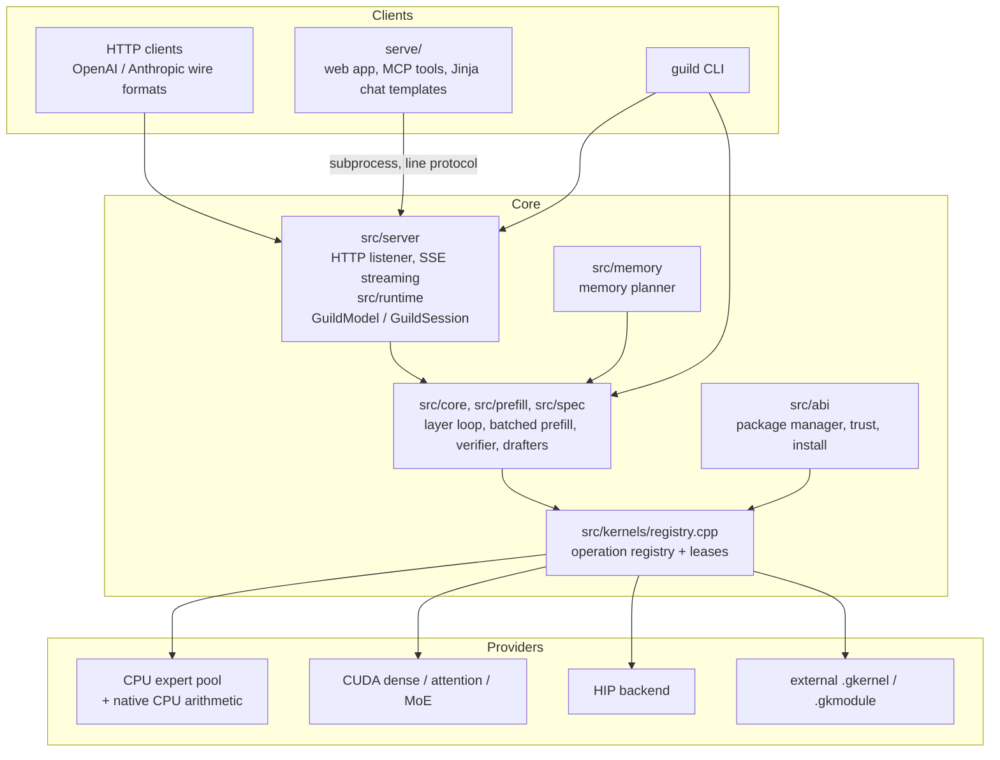
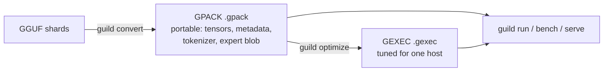

# Architecture

Guild runs a mixture-of-experts model on one normal PC: one GPU (NVIDIA or AMD) plus system RAM, on Windows or
Linux. The engine is C++ (CUDA or HIP kernels); a Python layer in `serve/` provides the web app and the
Anthropic-shaped API in front of the engine's OpenAI-compatible server.

This file is the map. It says what the parts are, how a token flows through them, and which document has the
detail - it repeats none of them.

## The three layers, and the one rule

| Layer | Lives in | Owns |
| --- | --- | --- |
| **Core / orchestration** | `src/runtime`, `src/core`, `src/memory`, `src/plan`, `src/prefill`, `src/spec`, `src/artifact`, `src/abi`, `src/server`, `src/cli`, `src/models` | Loading, the memory plan, the layer and token loops, speculative decoding, containers, packages, HTTP, CLI, the model store |
| **Model runners** | `include/guild/model/runner.hpp`, `src/model/` | Per-architecture mapping of container metadata and tensors to a `ModelDescriptor`, the required operations, the geometry and capability checks |
| **Hardware kernels** | `src/kernels`, `src/core/*.cu`, `plugins/`, `sycl/` | The arithmetic: the CPU expert pool (AVX2 / AVX-512 / NEON), CUDA dense, attention and MoE, HIP, plus external providers |

The rule that keeps them decoupled: **resolution happens once, off the hot path**. Core asks the
`KernelRegistry` for one implementation per operation while the model loads, keeps the resulting function
pointers and package ids, and then calls them directly. Inside a token or layer loop there is no virtual
dispatch and no registry lookup - see
[MODULAR_RUNTIME.md](MODULAR_RUNTIME.md#execution-lifecycle--zero-overhead-hot-path) for why that is a hard rule
and not a preference.

The layers meet at two contracts:

* the C ABI in `include/guild/abi/` (`kernel_abi.h`, `cpu_expert_abi.h`, runner and lifecycle headers) - plain
  values, explicit error info, no C++ types across the boundary;
* the `.gkmetadata` / `.gkernel` / `.gkmodule` package format, which is how a provider that was not compiled
  into this binary gets loaded, verified and leased
  ([KERNEL_ABI.md](KERNEL_ABI.md), [GKERNEL_FORMAT.md](GKERNEL_FORMAT.md), [GKMODULE.md](GKMODULE.md)).

A consequence worth knowing: the same Core builds a CPU-only engine, a CUDA engine and (experimental) a SYCL
engine, and which kernels exist is a build-time and load-time question, not a set of `#ifdef`s in the loops.

## Component map

## Artifacts: what a model is on disk

* **GGUF** is the import format, and remains a valid one: the runtime can load shards directly.
* **GPACK** ([GPACK_FORMAT.md](GPACK_FORMAT.md)) is the portable container: one memory-mapped file with the
  tensor index, dense weights, optional embedded expert blob, tokenizer assets and auxiliary models. The mapping
  *is* the model - weights are views, not copies.
* **GEXEC** ([GEXEC_CONTRACT.md](GEXEC_CONTRACT.md)) is not a model: it is what this machine measured about
  running that model (kernel selection, expert layout, placement plan, workspace sizes), pinned to a hardware
  and ABI fingerprint. An artifact that does not match is ignored with a reason, never used approximately.

## Memory hierarchy

The planner (`src/memory/planner.cpp`) places everything, and every tier below exists because VRAM is the scarce
resource; [CPU_GPU_WORKLOAD_ANALYSIS.md](../performance/CPU_GPU_WORKLOAD_ANALYSIS.md) has the measurements that
drove the split.

| Tier | Holds | Notes |
| --- | --- | --- |
| Device VRAM | Dense weights, KV/attention state, expert cache slots, scratch | Sized by the plan, finalised against live free VRAM at load |
| Pinned host RAM | RAM-resident expert complement, host KV tier | Locked pages for fast H2D; NUMA interleaved when locked pages do not fit |
| Mapped file | Experts the tiers above do not take | Zero-copy out of the GPACK; the page cache does the caching |
| Peer GPU | A second expert tier | Bit-identical expert rows, same kernels as the primary's hit path |

## Where to read next

| Document | Scope |
| --- | --- |
| [EXECUTION_LIFECYCLE.md](EXECUTION_LIFECYCLE.md) | Startup stages, session creation, prefill, the decode/speculative window, ownership and failure rules |
| [MODULAR_RUNTIME.md](MODULAR_RUNTIME.md) | The three layers in detail, phase status, the hot-path rule |
| [MODEL_RUNNERS.md](MODEL_RUNNERS.md) | What a runner is, how one is resolved from metadata, how to add one |
| [KERNEL_ABI.md](KERNEL_ABI.md), [GKERNEL_FORMAT.md](GKERNEL_FORMAT.md), [GKMODULE.md](GKMODULE.md) | The C ABI, `.gkernel` packages, runtime `.gkmodule` components |
| [GPACK_FORMAT.md](GPACK_FORMAT.md), [GEXEC_CONTRACT.md](GEXEC_CONTRACT.md) | Container layouts, identity and invalidation rules |
| [CPU_BACKEND_OWNERSHIP.md](CPU_BACKEND_OWNERSHIP.md), [CUDA_BACKEND_OWNERSHIP.md](CUDA_BACKEND_OWNERSHIP.md), [EXTERNAL_BACKENDS.md](EXTERNAL_BACKENDS.md), [REPOSITORY_SPLIT_PLAN.md](REPOSITORY_SPLIT_PLAN.md) | Which repository owns which arithmetic, and the gates between them |
| [PHASE2E_CONCURRENCY.md](PHASE2E_CONCURRENCY.md), [PHASE2E_PACKAGE_LIFECYCLE.md](PHASE2E_PACKAGE_LIFECYCLE.md) | Session/package concurrency and package lifetimes |
| [../quality/CODE_STYLE.md](../quality/CODE_STYLE.md), [../CONTRIBUTING.md](../CONTRIBUTING.md) | How to write and build code here |
| [../performance/](../performance/), [../quality/](../quality/), `bench/results/` | Measurements and audits - every number with the machine it was measured on |
